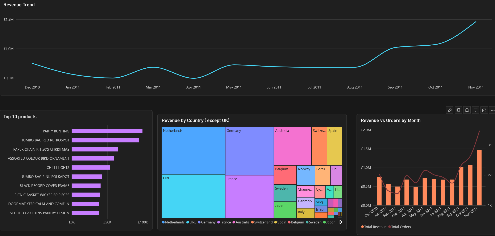
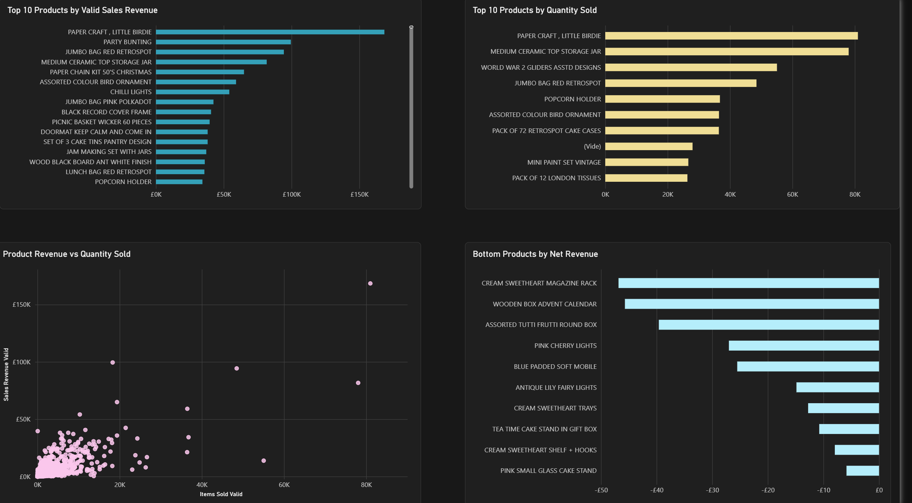
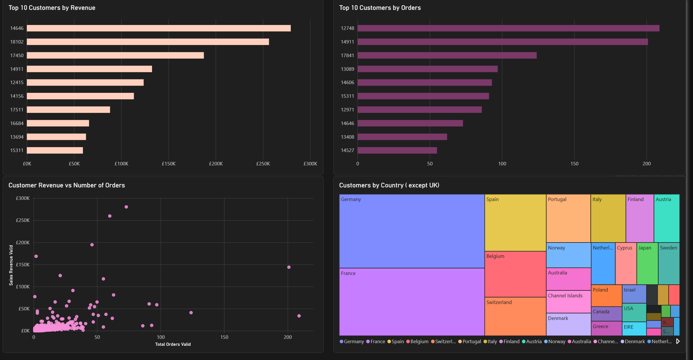

# Retail-Sales-Customer-Performance
## Project Overview
This project analyzes online retail transactions to explore sales trends, product performance, and customer purchasing behavior. The analysis is presented through an interactive Power BI dashboard.

## Business Objectives
- Analyze sales performance and trends over time.
- Identify top-performing products.
- Explore customer purchasing behavior.
- Support data-driven business decisions.

## Dataset
**Source:** UCI Machine Learning Repository — Online Retail Dataset  
**Period:** December 2010 – December 2011 (*Data Quality Note: December 2011 was excluded from the monthly trend analysis because the dataset only contains transactions for part of the month, ensuring consistent month-over-month comparisons.*)

## Tools & Technologies
- Power BI — Interactive dashboards and reporting
- Power Query — Data cleaning and transformation
- DAX — Business metrics and calculations
- Data Modeling — Star schema design

## Methodology
1. Cleaned and transformed retail transaction data using Power Query.
2. Designed a star schema for data analysis.
3. Created DAX measures to calculate business metrics.
4. Developed an interactive three-page Power BI dashboard.

## Dashboard Structure
### 1. Executive Overview
Overview of retail business performance and sales trends.

### 2. Product Performance
Analysis of product sales and performance.

### 3. Customer Analysis
Exploration of customer purchasing behavior.

## Key Insights

### 1. Sales Performance
- Revenue fluctuated throughout 2011, followed by a strong upward trend from September to November.
- November 2011 recorded the highest monthly revenue in the displayed period.
- Revenue and order volumes generally increased toward the end of the year, suggesting stronger commercial activity.

### 2. Product Performance
- A relatively small group of products generated a significant share of sales revenue.
- High sales volumes did not always correspond to the highest revenue, highlighting differences in product value.
- Several products generated negative net revenue, suggesting the need to investigate returns, cancellations, or other adjustments.

### 3. Customer Analysis
- Revenue was concentrated among a limited number of high-value customers.
- Customers with similar order frequencies sometimes generated significantly different revenue levels.
- Germany and France represented substantial shares of the customer base outside the United Kingdom.

### 4. Business Recommendations
- Investigate the drivers of the year-end increase in sales.
- Prioritize high-performing products while monitoring products with negative net revenue.
- Develop targeted retention strategies for high-value customers.
- Explore opportunities in international markets with established customer demand.

## Dashboard Screenshots

#### 1. Executive Overview

#### 2. Product Performance

#### 3. Customer Analysis

  
## Project Files
[Download the Power BI Dashboard](Retail%20Sales%20%26%20Customer%20Performance%20Dashboard.pbix)

